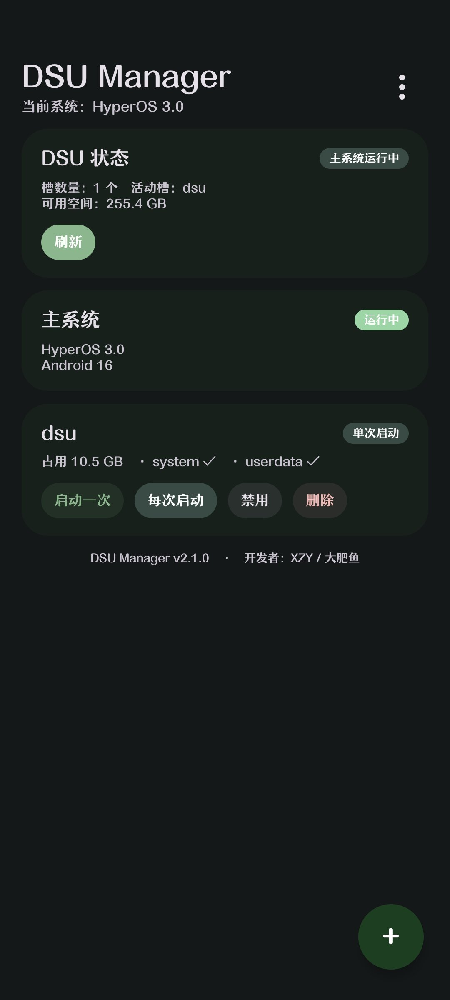
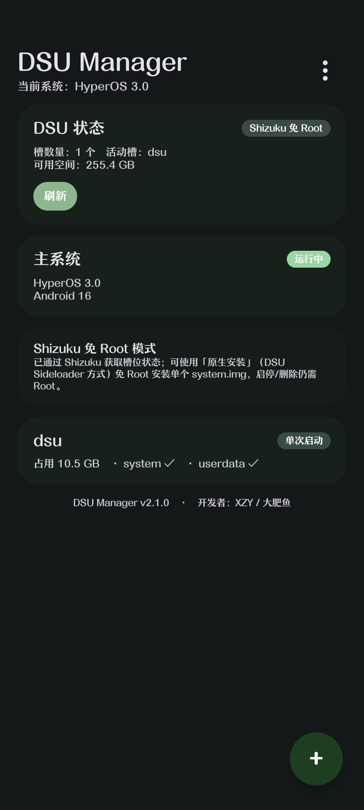
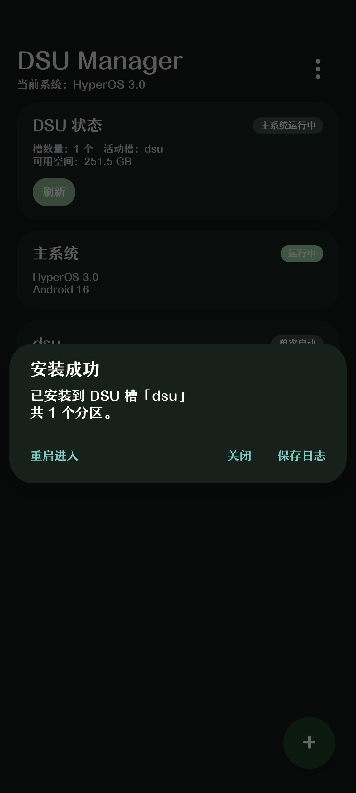
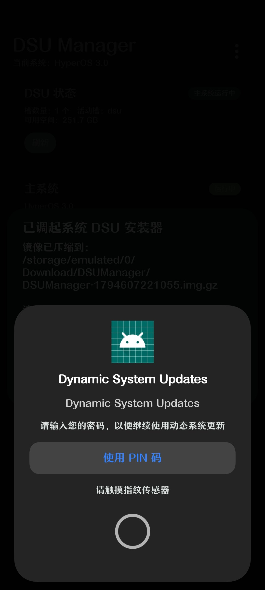
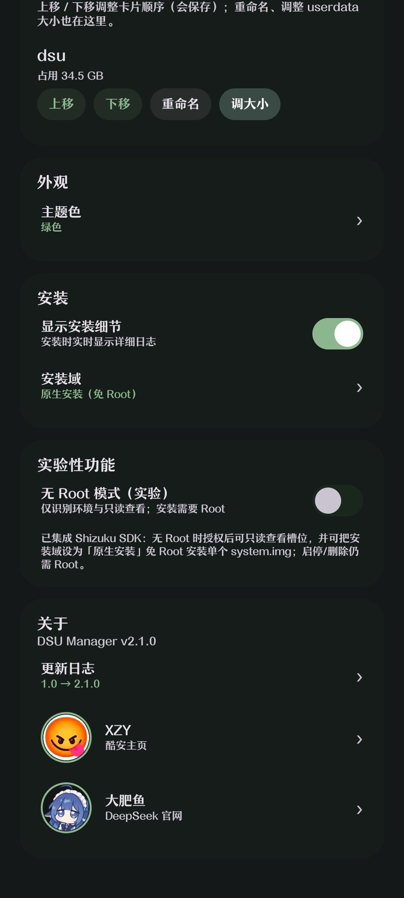
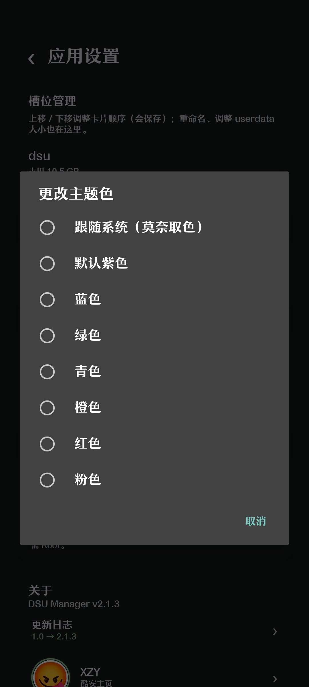

# DSU Manager

> 在 Android 上管理 DSU（Dynamic System Updates，动态系统更新）多槽的 Material 3 工具。
> 支持 Root（KernelSU / Magisk / APatch）与 **Shizuku 免 Root 原生安装**，无需电脑。


## 简介

**DSU Manager** 是一个面向 DSU（动态系统更新）的 Android 应用：把 GSI / ROM 安装到独立的
`dsu` 槽中，重启即可体验，失败也能随时回到主系统，不会改动只读分区。

它最初只因 Redmi K70 Pro 的 HyperOS 上 DSU 体验糟糕而写：系统只允许一个槽、安装入口难用、
看不到日志。现在它支持多槽管理、完整的镜像/压缩包识别、安装日志导出，以及在**没有 Root**时
通过 Shizuku 调起系统 DSU 安装器完成安装。

- 测试设备：**Redmi K70 Pro（manet / 23117RK66C）**，HyperOS 3.0（Android 16），KernelSU
- 理论支持 Android 11 ~ 17（minSdk 30 / targetSdk 36）
- 纯 Java + 原生 Android View（无 AndroidX / Compose），单 APK 约 360 KB

## 界面

| 主界面（Root） | 主界面（Shizuku 免 Root） |
|---|---|
|  |  |

| 软件安装 | 原生安装 |
|---|---|
|  |  |

| 设置 | 更改主题色 |
|---|---|
|  |  |

## 功能特性

### 安装
- **格式识别**：`system.img`、`super.img`、`zip`、`tar`、`gzip`、Android sparse；`zst` / `xz` 需系统自带命令
- **多分区安装**：`super.img` 自动拆分并逐分区写入；支持已拆分好的整包 ROM 文件夹
- **两种安装域**
  - **软件安装**：`gsi_tool` 分段管道写入，兼容性好，**需要 Root**
  - **原生安装**：DSU Sideloader 方式——本地压缩为 `.img.gz`，再调起系统
    `com.android.dynsystem` 完成安装；**无 Root 时只需 Shizuku 授权**
  - ⚠️ **原生安装只能安装单个 system.img（单个 DSU 槽）；需要多 DSU 槽时必须使用 Root 的软件安装**
- **原生安装自动清理**：调起系统 DSU 后轮询安装状态，安装完成自动删除 `Download/DSUManager/` 下的临时 `.img.gz`
- **完整日志**：安装过程实时日志；成功/失败弹窗带原因；日志只在点“保存日志”时通过 SAF 导出，
  不会自动写入应用目录
- **安装细节开关**：可关闭实时日志显示

### 槽位管理
- 多槽列表、占用空间/分区数/状态、system ✓ / userdata ✓ 标识
- 启动一次（单次启动）、每次启动（sticky）、禁用、删除
- 上移/下移排序、重命名、调整 userdata 大小（会重建 userdata）
- 刷新失败自动提示原因（权限 / SELinux / 空间不足 / gsi_tool 缺失等）

### 界面与体验
- Material 3 风格；Monet 动态取色 + 8 种预设主题色 + 自定义色
- 当前系统显示 **系统名**（HyperOS / ColorOS / LineageOS / MikuUI / Android）而不是设备名
- 设置页槽位管理使用缓存秒开；整行点击即切换开关
- 更新日志内置在「关于」页

### 环境与权限
- Root 模式：KernelSU / Magisk / APatch
- 无 Root 模式（实验）：通过 **Shizuku SDK** 只读读取槽位；把安装域切到「原生安装」后
  可通过 Shizuku 调起系统 DSU 安装器（Shizuku 需已启动并授权）
- 自动识别是否运行在 DSU 中，单独判断主系统状态，避免误判

## 安装与使用

### 下载
- 最新版本：见 [发布](https://github.com/15189659138/DSUManager/releases/latest)
- 历史版本：`apk/` 目录内含从 v1.0 到当前版本的全部 APK（也可在 [发布](https://github.com/15189659138/DSUManager/releases) 中下载）
- 123盘（不常更新）：https://4000162266.share.123pan.cn/123pan/46pUMh-Mps6v?pwd=9rDr#

### 要求
- Android 11+，设备支持 DSU（动态分区）
- Root（推荐，功能完整；**多 DSU 槽、super/整包、启停/删除槽都必须 Root**）
  或 [Shizuku](https://shizuku.rikka.app/)（免 Root：只读查看槽位 + 原生安装单个 system.img）
- 解锁 Bootloader（DSU 的常规要求）

### 快速开始
1. 打开应用并授予 Root 或 Shizuku 权限；
2. 点右下角 `＋` 选择镜像/压缩包/文件夹；
3. 设置槽名与 userdata 大小；
4. 点“开始安装”。软件安装需要 Root；原生安装会在无 Root 时自动使用 Shizuku；
5. 安装完成后可「启动一次」或「每次启动」，重启进入 DSU；
6. 安装日志可在结果弹窗里点“保存日志”通过 SAF 导出到任意位置。

### 原生安装（DSU Sideloader 方式）原理
```
system.img --gzip--> /sdcard/Download/DSUManager/<name>.img.gz
sh -c 'am start-activity -n com.android.dynsystem/com.android.dynsystem.VerificationActivity \
  -a android.os.image.action.START_INSTALL \
  -d file:///sdcard/Download/DSUManager/<name>.img.gz \
  --el KEY_USERDATA_SIZE <bytes> --el KEY_SYSTEM_SIZE <bytes>'
```
实际写入由系统 `com.android.dynsystem` 完成，因此 shell 身份（Shizuku）即可，无需 Root。
安装完成后会自动删除 `Download/DSUManager/` 下的临时 `.img.gz` 压缩包。
思路与 [DSU Sideloader](https://github.com/VegaBobo/DSU-Sideloader) 一致。

> ⚠️ **限制**：原生安装一次只能安装一个 `system.img`，对应单个 DSU 槽，且槽名固定为系统分配的 `dsu`。
> 如果你需要安装/管理**多个 DSU 槽**（或整包 ROM、super.img 多分区），必须使用 **Root + 软件安装**。

## 支持的格式

| 格式 | 说明 |
|---|---|
| `system.img` | 单系统镜像（原生安装 / 软件安装均支持） |
| `super.img` | 自动按 LP 元数据拆分为多分区安装（仅软件安装） |
| `.zip` / `.tar` | 自动查找其中的 `system.img` / `super.img` / 分区镜像 |
| `.gz` | 解压后按上面规则识别 |
| Android sparse | 自动转换为 raw |
| `.zst` / `.xz` | 需要设备上存在 `zstd` / `xz` 命令，否则提示不支持（仅软件安装） |

## 编译

本项目**不使用 Gradle**，用 Android SDK 的 `aapt2` + `javac` + `d8` + `zipalign` + `apksigner`
手动构建。详细步骤见 **[docs/BUILDING.md](docs/BUILDING.md)**。

```powershell
cd app
powershell -ExecutionPolicy Bypass -File .\build_apk.ps1
```

输出到 `apk/DSUManager-v<版本>.apk`。

## 目录结构

```
DSUManager/
├── app/                  # 源码（Java + res + Shizuku jars + 构建脚本）
│   ├── src/com/dsh/dsumanager/
│   ├── res/
│   ├── libs/             # Shizuku SDK 12.2.0 (api / provider / aidl / shared)
│   ├── AndroidManifest.xml
│   └── build_apk.ps1
├── apk/                  # 所有历史版本 APK
├── docs/                 # 编译说明 + 截图
├── README.md
├── CHANGELOG.md
└── LICENSE
```

## 版本

当前版本 **v2.1.0**。完整版本历史见 **[CHANGELOG.md](CHANGELOG.md)**，每个版本的 APK 都在
`apk/` 与 Releases 中提供。

## 致谢

- [Shizuku](https://github.com/RikkaApps/Shizuku)（RikkaApps）— 免 Root shell 能力
- [DSU Sideloader](https://github.com/VegaBobo/DSU-Sideloader) — 原生安装（VerificationActivity）思路
- KernelSU / Magisk / APatch — Root 方案
- 测试与反馈：酷安社区

## 免责声明

- DSU 安装不会修改只读分区，安装失败/不兼容时重启即可回到主系统；但 **userdata 与槽内数据
  可能因操作丢失**，重要数据请自行备份。
- 本项目按现状提供，作者不对刷机、数据丢失或设备损坏负责；请在理解风险后使用。
- 请使用你拥有合法授权的系统镜像。

## 开发者

- **XZY** — [酷安主页](https://www.coolapk.com/u/28096321)
- **大肥鱼** — [DeepSeek](https://www.deepseek.com/)

## License

[MIT](LICENSE)。第三方组件（Shizuku SDK）遵循其 Apache-2.0 许可，见 [THIRD_PARTY.md](THIRD_PARTY.md)。
